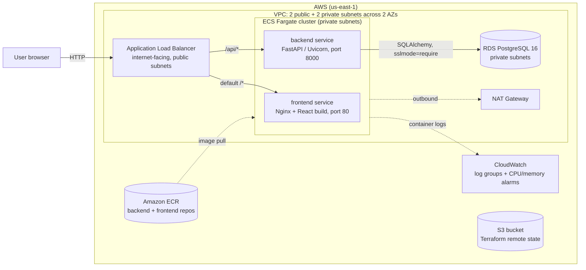
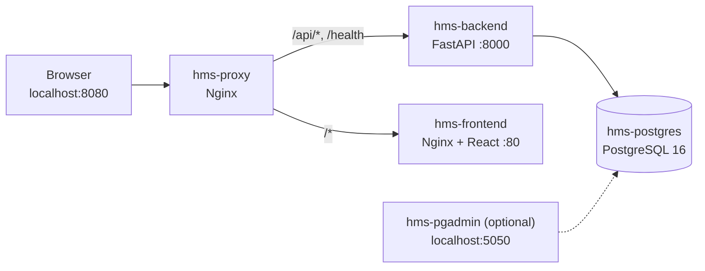
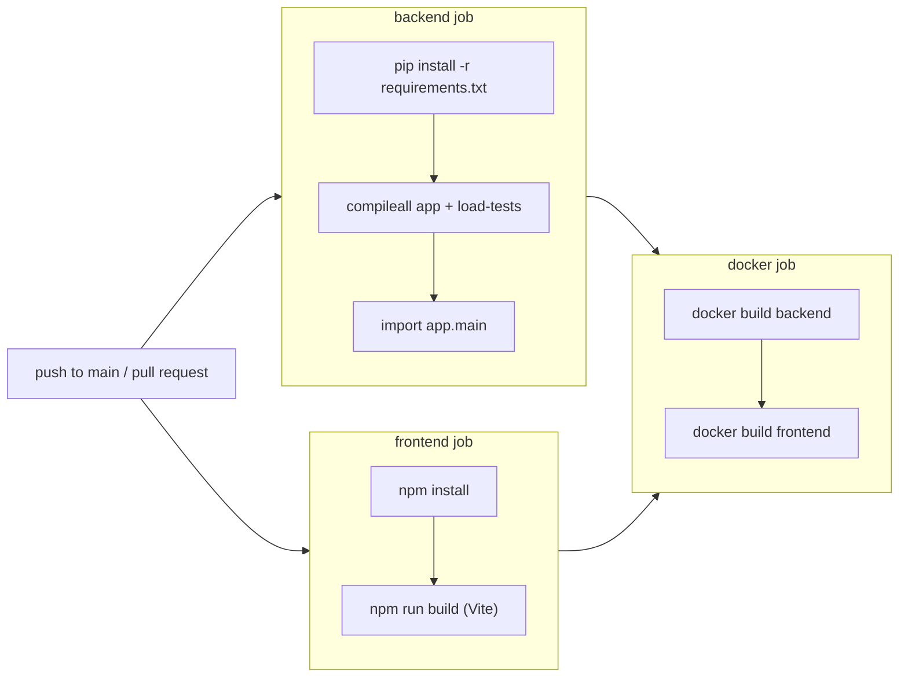

# Borderless Hospital Management System

A containerised hospital management system (FastAPI, React, PostgreSQL) deployed to AWS ECS Fargate behind an Application Load Balancer, with Amazon RDS, ECR and CloudWatch.

[](https://github.com/johntoby/borderless-hms/actions/workflows/ci.yml)
[](LICENSE)

---

## Table of Contents

- [Overview](#overview)
- [Architecture](#architecture)
- [Features](#features)
- [Tech Stack](#tech-stack)
- [Repository Structure](#repository-structure)
- [Getting Started Locally](#getting-started-locally)
- [Configuration](#configuration)
- [Deployment to AWS](#deployment-to-aws)
- [Load Testing](#load-testing)
- [API Overview](#api-overview)
- [Security Notes](#security-notes)
- [Roadmap](#roadmap)
- [License](#license)

---

## Overview

Borderless HMS lets hospital staff manage patients, doctors, departments and appointments from a single web app. The project focuses on the operational side of shipping such an application:

- Two independently built, multi-stage Docker images (FastAPI backend, React frontend served by Nginx), both running as non-root users with container health checks.
- A production deployment on AWS: ECS Fargate services in private subnets behind an internet-facing ALB, PostgreSQL on RDS over TLS, images in ECR, logs and alarms in CloudWatch, Terraform state in S3.
- A one-command local environment with Docker Compose and an Nginx reverse proxy that mirrors the ALB path routing.
- A Locust load-test suite modelling realistic read/write traffic against the API.
- A GitHub Actions CI pipeline that checks the backend, builds the frontend and builds both container images.

> Built by Johntoby for Borderless Tech Academy.

---

## Architecture

### AWS runtime architecture

As deployed to `us-east-1` (see [aws-setup.md](aws-setup.md) and the console screenshots in [`screenshots/`](screenshots)):



- The React app calls the API on the same origin (`/api/v1`), so the ALB's path-based routing sends `/api/*` to the backend target group and everything else to the frontend.
- ECS services scale on CPU/memory target tracking; RDS Multi-AZ is configurable (`rds_multi_az`).
- Infrastructure was provisioned with Terraform (state in S3). **The Terraform code is not yet committed to this repository** — see [Roadmap](#roadmap).

### Local development topology

`docker-compose.yml` reproduces the same routing locally, with [`nginx-proxy.conf`](nginx-proxy.conf) playing the role of the ALB:



### CI pipeline

[`.github/workflows/ci.yml`](.github/workflows/ci.yml) runs on every push to `main` and on pull requests:



The pipeline validates but does not deploy. Images were pushed to ECR and rolled out to ECS manually as described in [aws-setup.md](aws-setup.md); automating that is on the roadmap.

---

## Features

- **Authentication** — username/password login returning a JWT (HS256, 24 h expiry); passwords hashed with bcrypt.
- **Patients** — create, update, search (name, email, phone), paginate and soft-delete patient records, including blood type, allergies, medical history and insurance details.
- **Doctors and departments** — doctor profiles with specialisation, licence number, availability and department; department management.
- **Appointments** — booking with double-booking protection (HTTP 409 when a doctor already has an active appointment in the slot), filtering by patient, doctor, status and date range, a "today" view, and cancellation.
- **Dashboard** — headline counts (patients, doctors, appointments, today's and scheduled appointments).
- **Operations** — `/health` endpoint used by container and load-balancer health checks; interactive OpenAPI docs at `/api/v1/docs`.

---

## Tech Stack

| Layer | Technology |
|-------|------------|
| Frontend | React 18, Vite 5, Tailwind CSS, React Router, React Query, React Hook Form, Recharts, Axios |
| Backend | Python 3.12, FastAPI, Uvicorn (uvloop), SQLAlchemy 2, Pydantic v2 / pydantic-settings |
| Auth | JWT via python-jose, bcrypt via passlib |
| Database | PostgreSQL 16 (Amazon RDS in production) |
| Web server | Nginx (static frontend + local reverse proxy) |
| Containers | Docker multi-stage builds, Docker Compose |
| Cloud | AWS ECS Fargate, ALB, RDS, ECR, VPC + NAT Gateway, CloudWatch, S3 |
| IaC | Terraform (S3 remote state) — code not yet in this repo |
| CI | GitHub Actions |
| Load testing | Locust |

---

## Repository Structure

```
borderless-hms/
├── .github/workflows/ci.yml   # CI: backend checks, frontend build, Docker builds
├── backend/
│   ├── app/
│   │   ├── api/routes/        # auth, patients, doctors (+ departments), appointments
│   │   ├── api/deps.py        # JWT bearer-token dependency
│   │   ├── core/              # settings (env-driven) and security helpers
│   │   ├── db/                # SQLAlchemy engine, session and models
│   │   ├── schemas/           # Pydantic request/response models
│   │   └── main.py            # app factory, routers, /health, /api/v1/stats
│   ├── Dockerfile             # multi-stage, non-root, HEALTHCHECK
│   └── requirements.txt
├── frontend/
│   ├── src/                   # pages, components, auth context, API client
│   ├── Dockerfile             # Node build stage -> Nginx runtime
│   └── nginx.conf             # SPA routing, gzip, security headers, /health
├── load-tests/
│   ├── locustfile.py          # Locust scenarios
│   └── requirements.txt
├── screenshots/               # running app, AWS console and Locust screenshots
├── docker-compose.yml         # local stack
├── nginx-proxy.conf           # local reverse proxy (mirrors ALB routing)
├── .env.example               # configuration template (placeholders only)
├── aws-setup.md               # AWS deployment guide
├── localdev.md                # detailed local development guide
└── architecture-diagram.png   # illustrated architecture overview
```

---

## Getting Started Locally

Prerequisites: Docker Desktop 24+ (or Docker Engine with the Compose plugin) and Git.

```bash
git clone https://github.com/johntoby/borderless-hms.git
cd borderless-hms

cp .env.example .env
# Edit .env: set POSTGRES_PASSWORD and a SECRET_KEY of at least 32 characters:
openssl rand -hex 32

docker compose up --build
```

| URL | What |
|-----|------|
| http://localhost:8080 | Full application via the Nginx proxy |
| http://localhost:8000/api/v1/docs | Swagger UI for the API |
| http://localhost:8080/health | Backend health check |

On first start the backend creates the schema and seeds an `admin` superuser (default password defined in [`backend/app/main.py`](backend/app/main.py)). Change it before exposing the app anywhere.

Optional pgAdmin: `docker compose --profile tools up -d pgadmin`, then open http://localhost:5050.

Stop with `docker compose down` (keeps data) or `docker compose down -v` (also deletes the database volume). See [localdev.md](localdev.md) for rebuilding individual services, logs and database access.

---

## Configuration

The backend reads its settings from environment variables (or `.env`) via `pydantic-settings` in [`backend/app/core/config.py`](backend/app/core/config.py). Copy [`.env.example`](.env.example) and fill in your own values.

| Variable | Required | Purpose |
|----------|----------|---------|
| `POSTGRES_SERVER` | | Database host (RDS endpoint in AWS; overridden to `postgres` by Compose) |
| `POSTGRES_PORT` | | Database port |
| `POSTGRES_USER` | | Database user |
| `POSTGRES_PASSWORD` | yes | Database password; startup fails if missing or a known weak value |
| `POSTGRES_DB` | | Database name |
| `POSTGRES_SSL_MODE` | | `require` for RDS, `disable` locally |
| `SECRET_KEY` | yes | JWT signing key; startup fails if shorter than 32 characters or a known weak value |
| `ALGORITHM` | | JWT algorithm |
| `ACCESS_TOKEN_EXPIRE_MINUTES` | | Token lifetime |
| `BACKEND_CORS_ORIGINS` | | JSON list of allowed origins |
| `ENVIRONMENT` | | Reported by `/health` |
| `DEBUG` | | Debug flag |

Other variables: `VITE_API_URL` (frontend build argument), `LOAD_TEST_USERNAME` / `LOAD_TEST_PASSWORD` (Locust), `PGADMIN_DEFAULT_EMAIL` / `PGADMIN_DEFAULT_PASSWORD` (optional local pgAdmin). The `AWS_*` entries in `.env.example` are for deployment tooling and are not read by the application.

---

## Deployment to AWS

The full walkthrough is in **[aws-setup.md](aws-setup.md)**. In summary:

1. Configure the AWS CLI for `us-east-1`.
2. Create `terraform.tfvars` with the database password and JWT secret (never committed).
3. `terraform apply -target=module.ecr` to create the backend and frontend ECR repositories.
4. Build both images and push them to ECR (frontend built with `VITE_API_URL=/api/v1`).
5. Optionally move Terraform state to an encrypted S3 backend with lockfile-based locking.
6. `terraform plan` / `apply` the VPC, NAT Gateway, security groups, RDS, ALB, ECS cluster and services, auto-scaling policies and CloudWatch log groups and alarms.
7. Verify via `curl http://<ALB_DNS>/health` and `aws ecs describe-services`.

Operational commands for tailing CloudWatch logs, `aws ecs execute-command` shell access, cost tuning and teardown are in the same guide.

---

## Load Testing

[`load-tests/locustfile.py`](load-tests/locustfile.py) defines two user types:

- `HospitalUser` — staff browsing with 1–3 s think time: dashboard stats, patient/doctor/appointment listings, record lookups, search, and a smaller share of writes (new patients and appointments).
- `HighLoadReadUser` — burst read traffic with 0.1–0.5 s waits against stats, patients and today's appointments.

A test-start hook logs in and collects existing doctor and patient IDs so that detail and booking requests hit real records.

```bash
cd load-tests
pip install -r requirements.txt
export LOAD_TEST_USERNAME=admin
export LOAD_TEST_PASSWORD='<admin password>'

# Web UI at http://localhost:8089
locust -f locustfile.py --host=http://localhost:8080

# Headless
locust -f locustfile.py --host=http://<ALB_DNS_NAME> \
  --users=50 --spawn-rate=5 --run-time=5m --headless
```

**Recorded result.** The only result in the repo is a screenshot of a run against the production ALB ([`screenshots/locust-pproduction'.png`](screenshots/locust-pproduction'.png)): 0% failures at about 11 requests/second aggregate, with medians of 250–260 ms and 95th percentiles of 270–280 ms on the endpoints visible. The user count for that run is not recorded, and no higher-load results are committed yet.

---

## API Overview

All endpoints except `/health`, `/api/v1/auth/login` and `/api/v1/auth/register` require an `Authorization: Bearer <token>` header. Full schemas are in the Swagger UI at `/api/v1/docs`.

| Method | Path | Description |
|--------|------|-------------|
| POST | `/api/v1/auth/register` | Create a user |
| POST | `/api/v1/auth/login` | Exchange username/password for a JWT |
| GET | `/api/v1/auth/me` | Current user |
| GET | `/api/v1/patients` | List patients (`page`, `size`, `search`) |
| POST | `/api/v1/patients` | Create patient |
| GET / PUT / DELETE | `/api/v1/patients/{id}` | Read, update, soft-delete patient |
| GET | `/api/v1/doctors` | List doctors (`search`, `department_id`, `specialization`) |
| POST | `/api/v1/doctors` | Create doctor |
| GET / PUT / DELETE | `/api/v1/doctors/{id}` | Read, update, soft-delete doctor |
| GET / POST | `/api/v1/doctors/departments` | List or create departments |
| GET | `/api/v1/appointments` | List appointments (`patient_id`, `doctor_id`, `status`, `date_from`, `date_to`) |
| POST | `/api/v1/appointments` | Book appointment (409 on slot conflict) |
| GET | `/api/v1/appointments/today` | Today's appointments |
| GET / PUT | `/api/v1/appointments/{id}` | Read, update appointment |
| DELETE | `/api/v1/appointments/{id}` | Cancel appointment (status set to `cancelled`) |
| GET | `/api/v1/stats` | Dashboard counts |
| GET | `/health` | Liveness/health check |

---

## Security Notes

- **Secrets come from the environment.** Database credentials and the JWT signing key are injected through environment variables (`.env` locally, Terraform variables in AWS). The backend refuses to start without them, and rejects known-weak values and short JWT keys.
- **`.env` is never committed.** `.gitignore` excludes `.env` and `.env.*` (except `.env.example`, which contains placeholders only). `terraform.tfvars` must also stay out of version control.
- **JWT authentication.** Tokens are signed with HS256 and expire after 24 hours by default; passwords are stored as bcrypt hashes.
- **Network isolation in AWS.** Only the ALB is internet-facing; ECS tasks and RDS sit in private subnets, and the backend connects to RDS with `sslmode=require`.
- **Container hardening.** Both images run as non-root users and define health checks; the frontend Nginx config sets `X-Frame-Options`, `X-Content-Type-Options` and `Referrer-Policy` headers.

Known gaps, tracked below: the seeded admin password is hard-coded, `/auth/register` is open and accepts any role, role-based authorisation is not enforced on endpoints, and the ALB listener is HTTP only.

---

## Roadmap

Honest next steps towards a production-grade service:

- [ ] Commit the Terraform modules (VPC, ECR, RDS, ALB, ECS, auto-scaling, CloudWatch, S3 state) that were used to provision AWS.
- [ ] Extend CI into CD: push images to ECR tagged with the git SHA using GitHub OIDC (no long-lived AWS keys), then roll out to ECS.
- [ ] Add a pytest suite (API tests against a Postgres service container) and run it in CI; add linting (ruff, ESLint).
- [ ] Commit `package-lock.json` and switch CI and the frontend Dockerfile to `npm ci`.
- [ ] HTTPS on the ALB with an ACM certificate and HTTP-to-HTTPS redirect.
- [ ] Move the seeded admin password and runtime secrets to AWS Secrets Manager.
- [ ] Enforce role-based authorisation and restrict self-registration.
- [ ] Use Alembic migrations instead of `create_all` at startup.
- [ ] Wire up the already-listed `prometheus-fastapi-instrumentator` (`/metrics`) and `slowapi` rate limiting.
- [ ] Publish reproducible load-test results (user count, duration, p95/p99, error rate, scaling events).

---

## License

Released under the [MIT License](LICENSE). Copyright (c) 2026 John Idowu.
